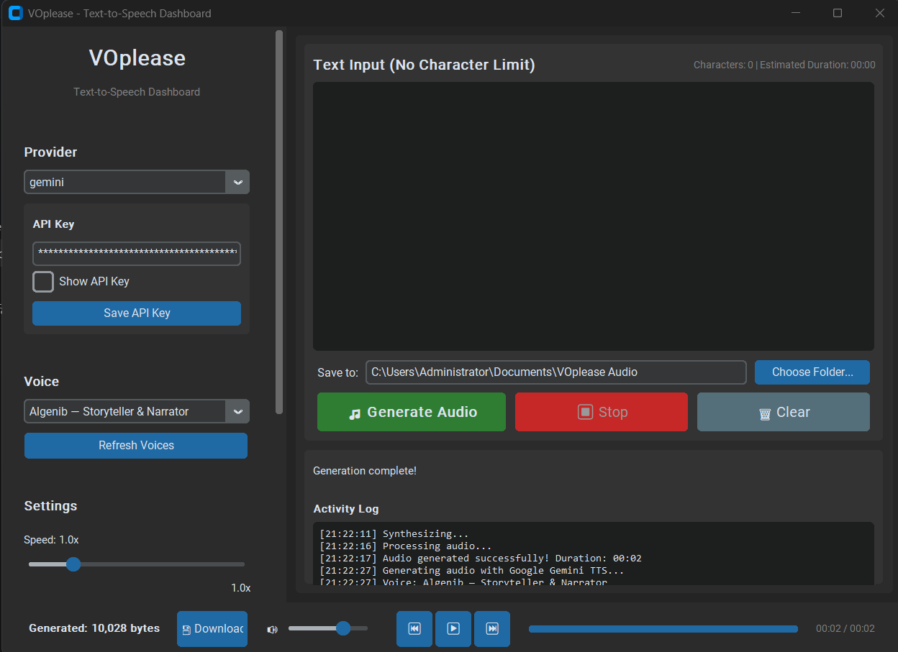

# VOplease — Text-to-Speech Dashboard

A powerful, standalone Windows desktop application for text-to-speech generation with multiple providers, voice selection, speed control, unlimited text length, and audio playback/download.



---

## Features

### Multi-Provider Support
| Provider | API Key Required | Free Tier | Speed Control | Voices |
|---|---|---|---|---|
| **Edge TTS** | ❌ No | ✅ Yes | ✅ 0.25x–4x | 30+ voices (EN, ES, FR, DE, IT, PT, JA, KO, ZH) |
| **ElevenLabs** | ✅ Yes | 10k chars/mo | ✅ Via settings | 100+ voices, voice cloning |
| **Azure Speech** | ✅ Yes | 5M chars/mo | ✅ 0.5x–2x | 50+ voices |
| **SiliconFlow** | ✅ Yes | Free tier | ✅ 0.5x–2x | Fish Speech, ChatTTS |
| **Google Gemini TTS** | ✅ Yes | Provider-dependent | ✅ Style-guided | Live Gemini Voice Library |

### Core Features
- **Unlimited text length** — No character limits, chunked processing for long texts
- **Voice selection** — Browse and preview all available voices per provider
- **Speed control** — 0.25x to 4x speed adjustment
- **Pitch control** — -20 to +20 semitone adjustment
- **Volume control** — 0% to 200% volume
- **Multiple formats** — MP3, WAV, OGG output
- **Audio player** — Built-in playback with seek, pause, volume
- **Choose output folder** — Pick and remember where generated files are saved
- **Download** — Save generated audio as MP3/WAV/OGG
- **Dark/Light theme** — System-aware theme with manual toggle
- **Encrypted API keys** — Keys stored encrypted locally
- **Activity log** — Real-time generation logs
- **No character limit** — Paste entire books, articles, scripts

---

## Quick Start

### Option 1: Install on Windows (Recommended)

Download `VOplease-Setup-v1.0.0.exe` from the
[latest release](https://github.com/baturdenada/VOplease/releases/latest), run it,
and launch VOplease from the desktop shortcut. No Python installation is needed.

### Option 2: Portable EXE

Download `VOplease.exe` from the
[latest release](https://github.com/baturdenada/VOplease/releases/latest) and run it directly.

### Option 3: Run from Source (Python)
```powershell
git clone https://github.com/baturdenada/VOplease.git
cd VOplease
pip install -r requirements.txt
python main.py
```

### Option 4: Build EXE (Windows)
```powershell
pip install -r requirements.txt
pip install pyinstaller pillow
python build.py
# Output: dist/VOplease.exe
```

## Usage

1. **Launch** — Run `VOplease.exe` or `python main.py`
2. **Select Provider** — Choose from dropdown (Edge TTS is free, no key needed)
3. **Enter API Key** (if required) — Click "Save API Key" to store encrypted
4. **Choose Voice** — Select from available voices for your provider
4. **Adjust Settings** — Speed (0.25x–4x), Pitch (-20 to +20), Volume (0–200%)
5. **Paste Text** — No character limit, paste entire chapters
5. **Generate** — Click "Generate Audio" and wait
6. **Choose Folder** — Select where generated audio should be saved
7. **Play/Download** — Preview with the built-in player, then save as MP3/WAV/OGG

---

## Architecture

```
VOplease/
├── main.py                 # Main application entry point
├── build.py                # PyInstaller build script
├── requirements.txt        # Python dependencies
├── config/
│   └── manager.py         # Encrypted config management
├── providers/
│   ├── __init__.py        # Provider registry
│   ├── base.py            # Abstract base class
│   ├── edge_tts.py        # Microsoft Edge TTS (free)
│   ├── elevenlabs.py      # ElevenLabs
│   ├── azure_tts.py       # Azure Speech
│   ├── siliconflow.py     # SiliconFlow
│   └── gemini_tts.py      # Gemini Developer API TTS
├── config/
│   └── manager.py         # Encrypted config (Fernet)
├── utils/
│   ├── audio_player.py    # Pygame-based audio player
│   └── helpers.py         # Utility functions
└── assets/
    └── icon.ico           # App icon
```

---

## Provider Setup

### Edge TTS (Free, No Key)
- Works out of the box
- 30+ voices across 10+ languages
- No account needed

### ElevenLabs
1. Get API key from [elevenlabs.io](https://elevenlabs.io)
2. Paste in VOplease → Save API Key
3. Access 100+ voices + voice cloning

### Azure Speech
1. Create resource at [Azure Portal](https://portal.azure.com)
2. Get key + region (e.g., `eastus`)
3. Paste key in VOplease

### SiliconFlow
1. Get key from [siliconflow.cn](https://siliconflow.cn)
2. Paste in VOplease

### Google Gemini TTS
1. Create a Gemini Developer API key in Google AI Studio
2. Select `gemini` in VOplease
3. Paste the key and click **Save API Key**
4. Refresh voices, choose a voice, and generate WAV, MP3, or OGG audio

Gemini uses the Developer API directly; Google Cloud Application Default
Credentials are not required. Long text is split into ordered chunks and joined
into one final audio file.

---

## Building Standalone EXE

```powershell
# Install build dependencies
pip install pyinstaller pillow

# Run build script
python build.py

# Output: dist/VOplease.exe (~50-80MB)
```

The EXE is fully self-contained — no Python installation needed on target machine.

---

## Configuration

Settings are stored in `%APPDATA%\VOplease\settings.json`:
- Provider API keys (encrypted with Fernet)
- Last used provider, voice, speed
- Theme preference
- Output format preference
- Output directory preference

API keys are never included in the application or public repository. They are
stored only in the current Windows user's encrypted local configuration.

---

## Keyboard Shortcuts

| Key | Action |
|---|---|
| `Ctrl+Enter` | Generate audio |
| `Space` | Play/Pause |
| `Ctrl+S` | Download audio |
| `Ctrl+L` | Clear text |
| `Escape` | Stop generation |

---

## Troubleshooting

### "No module named X"
```powershell
pip install -r requirements.txt
```

### Audio not playing
- Ensure `pygame` installed: `pip install pygame`
- Check Windows audio permissions

### Edge TTS voices not loading
- Check internet connection (required for voice list)
- Try refreshing voices

### API key not working
- Verify key is correct
- Check provider status page
- Ensure key has TTS permissions

---

## License

MIT License — Free for personal and commercial use.

---

## Credits

- **Edge TTS** — Microsoft's free neural TTS
- **ElevenLabs** — Premium AI voice synthesis
- **Azure Speech** — Microsoft Cognitive Services
- **SiliconFlow** — AI model inference platform
- **MoneyPrinterTurbo** — Voiceover integration reference
- **CustomTkinter** — Modern Tkinter wrapper
- **Pygame** — Audio playback

---

## Roadmap

- [ ] Batch processing (multiple texts → multiple files)
- [ ] SSML support for fine-grained control
- [ ] Voice cloning (ElevenLabs, Coqui)
- [ ] Pronunciation dictionary
- [ ] WebUI mode (Streamlit/FastAPI)
- [ ] Plugin system for custom providers
- [ ] Cloud sync for settings
- [ ] Mac/Linux support

---

**VOplease** — Your personal TTS studio. Simple, powerful, free to start.
